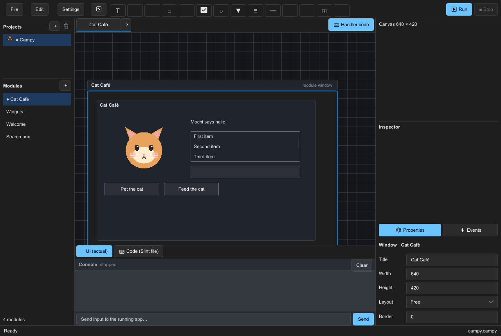

# Campy



**Idea:** A native, Gleam-first RAD studio. Design forms, edit properties and handlers, and run the result in a live window. The IDE uses the same component model and runtime as the apps it builds.

**Why:** Keep application state and behavior on the BEAM; use Slint for native rendering. A small Rust NIF owns the UI thread and passes events to Gleam. Forms can update without rebuilding the bridge.

## Requirements

- Rust 1.92+, Gleam 1.16+, Erlang/OTP 27+, Python 3, `just`, Bash.
- Linux: Wayland or X11 and Winit runtime libraries; X11 also needs `libxkbcommon-x11`.
- Windows: Git Bash on `PATH`. macOS startup is not implemented.
- Network access for the first dependency build.

## Install and run

```sh
git clone https://github.com/fralalonde/campy.git
cd campy
just doctor
just run
```

`just run` builds Rust and Gleam, stages the NIF, and opens Campy Studio. On Linux, `./campy` is an equivalent launcher. Development: `just dev` watches Gleam sources; `just check` runs formatting and tests. There is no packaged installer yet.

## State and limits

- Working prototype: project/workspace persistence, form designer, property inspector, undo/redo, native preview, and F7 updates to a running form.
- Handler stubs can be edited, but the preview does not execute handler code. Its console logs events and input.
- F6 reloads Gleam code in the IDE; Rust/NIF changes and state-shape changes need a restart.
- Palette drag-and-drop, richer source editing, and the general versioned component schema are unfinished.
- Native sessions run on Linux and Windows. Windows context-menu input is not covered by the automated smoke test.

Architecture and roadmap: [architecture](docs/ARCHITECTURE.md) · [MVP](docs/MVP.md).
